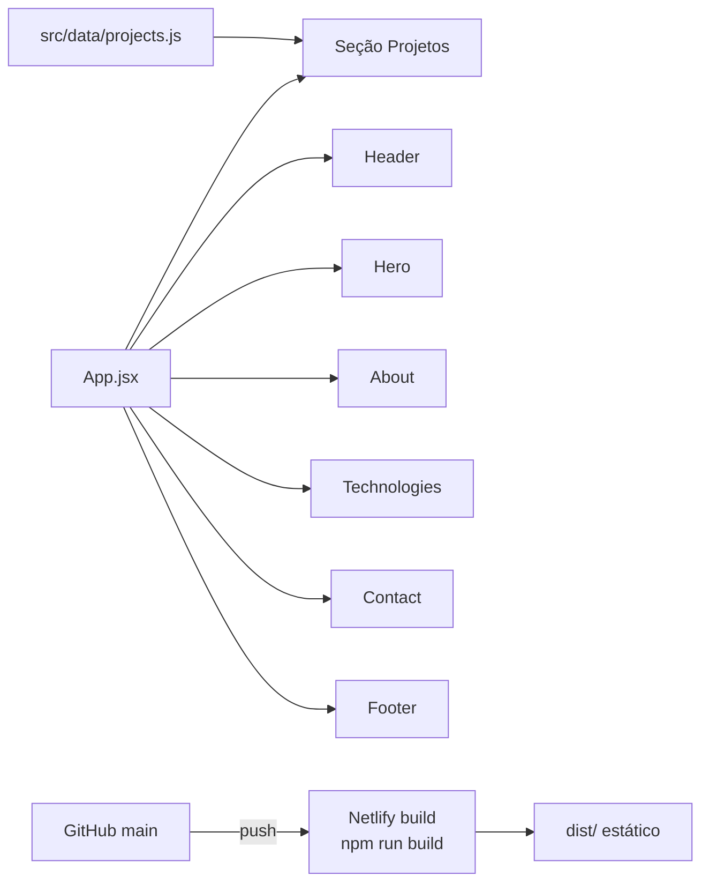

# Pablo Costa — Portfólio

Site pessoal de Pablo Costa, desenvolvedor backend: trajetória, tecnologias e projetos, para recrutadores e
quem quiser conhecer meu trabalho.

[](https://app.netlify.com/projects/portfolio-pablosscosta/deploys)


## Demonstração
No ar em **[portfolio-pablosscosta.netlify.app](https://portfolio-pablosscosta.netlify.app/)**.

## Funcionalidades
- Página única com as seções Início, Sobre, Tecnologias, Projetos e Contato.
- Header fixo que destaca a seção visível no momento (IntersectionObserver) e menu responsivo no celular.
- Animação de entrada das seções ao rolar a página, desligada para quem prefere menos movimento
  (`prefers-reduced-motion`).
- Projetos vindos de um arquivo de dados (`src/data/projects.js`): cards em destaque com vídeo de
  demonstração (dados fictícios) e links para o repositório e a demo, uma grade para projetos secundários e
  um aviso "Em breve".
- Vídeo de demonstração em loop no card, que só carrega e toca enquanto aparece na tela; o clique abre o
  vídeo ampliado num player com controles e tela cheia. Para quem prefere menos movimento, nada toca
  sozinho.
- Layout responsivo para desktop, tablet e celular.

## Tecnologias
| Tecnologia | Por quê |
| --- | --- |
| React 19 | Componentes pequenos e reutilizáveis para as seções e os cards de projeto |
| Vite 8 | Dev server e build rápidos, sem configuração extra |
| CSS puro (um arquivo por componente) | O site é pequeno; não justifica framework de CSS nem CSS-in-JS |
| lucide-react / react-icons | Ícones como componentes, sem carregar fontes de ícones |
| ESLint | Padrão de código e regras dos hooks do React |
| Vitest + Testing Library | Testes do que o visitante vê e faz, como abrir e fechar o player |
| Netlify | Hospedagem estática gratuita com deploy automático a cada push na `main` |

## Arquitetura


É uma SPA estática de página única: o `App.jsx` monta as seções em ordem, e a navegação usa âncoras
(`#projects`), então não há roteador. Os projetos ficam separados da apresentação em `src/data/projects.js`:
adicionar um projeto é editar só esse arquivo. O build e a versão do Node estão versionados em
`netlify.toml`, para o deploy não depender de configuração no painel.

## Como rodar localmente
Pré-requisitos: Node.js 20.19+ ou 22.12+ (exigência do Vite 8; o deploy usa Node 24). Não há variáveis de
ambiente.

```bash
npm ci
npm run dev        # http://localhost:5173
npm run lint
npm test           # testes em modo watch
npm run build      # gera dist/
npm run preview    # serve o build de produção
```

## Testes
```bash
npm test            # modo watch
npm test -- --run   # uma vez
```

- **Projetos (`src/sections/Projects.test.jsx`)**: guiados pelos dados, então um projeto novo já entra
  testado. Cada um mostra a descrição, os links para o GitHub e a demo e a legenda do vídeo.
- **Player (`src/components/ProjectVideo.test.jsx`)**: a prévia só toca enquanto aparece na tela; o player
  abre ao clicar nela, fecha pelo botão e pelo fundo e pausa ao fechar. Também confere o aviso no console
  quando o vídeo não pode começar sozinho e o respeito a `prefers-reduced-motion`.

O jsdom não implementa `<dialog>`, reprodução de mídia nem `IntersectionObserver`: `src/test/setup.js` tem
só o mínimo para abrir e fechar o player, e `src/test/intersectionObserver.js` deixa o teste dizer quando a
prévia entra ou sai da tela. Foco preso e Esc ficam a cargo do navegador real. Os testes ainda não rodam no
deploy nem em CI (veja os próximos passos).

## Decisões e aprendizados
- **Dados separados da apresentação:** os projetos vivem em `src/data/projects.js`; os componentes só
  renderizam o que existe (links reais ou "em breve").
- **Até 3 destaques em lista:** todo projeto com `featured: true` usa o card horizontal, com vídeo e texto
  lado a lado. Cada destaque ocupa uns ⅔ de tela no desktop e mais de uma tela no celular, então do quarto
  projeto em diante eles vão para a grade (`featured: false`), com imagem. Os dois atuais são destaques
  porque um projeto sozinho na grade ocuparia a largura inteira, com um vídeo maior que o do principal.
- **Player com `<dialog>` nativo:** o navegador já prende o foco, fecha com Esc, deixa o resto da página
  inerte e devolve o foco à prévia ao fechar, sem biblioteca de modal. A tela cheia vem dos controles do
  próprio `<video>`.
- **Vídeo só quando aparece:** vídeos e pôsteres são mais de 90% do peso da página, e com `autoplay` o
  navegador baixava os vídeos assim que ela abria, mesmo fora da tela. A prévia usa `preload="none"`, e um
  `IntersectionObserver` a toca quando o card aparece e pausa quando sai. O `loading="lazy"` não serve: só
  existe para `` e `<iframe>`.
- **Projetos já na primeira tela:** o hero tinha a altura da tela (`100vh`) com metade dela vazia; agora a
  altura vem do conteúdo, e o início da seção de projetos aparece sem rolar.
- **Grade em vez de carrossel:** com poucos projetos, a grade mostra tudo de uma vez, é só CSS e funciona
  bem no celular.
- **Configuração de deploy como código:** `netlify.toml` fixa o comando de build, a pasta publicada e a
  versão do Node.

## Próximos passos
- Migrar para TypeScript em modo strict.
- CI no GitHub Actions (lint, build e testes em todo PR).
- Página "Ver todos os projetos" quando houver mais projetos.
- Adicionar uma licença.

## Autor
**Pablo Costa**
- LinkedIn: [linkedin.com/in/pablosilva013](https://www.linkedin.com/in/pablosilva013)
- GitHub: [github.com/pablosscosta](https://github.com/pablosscosta)
- Portfólio: [portfolio-pablosscosta.netlify.app](https://portfolio-pablosscosta.netlify.app/)
