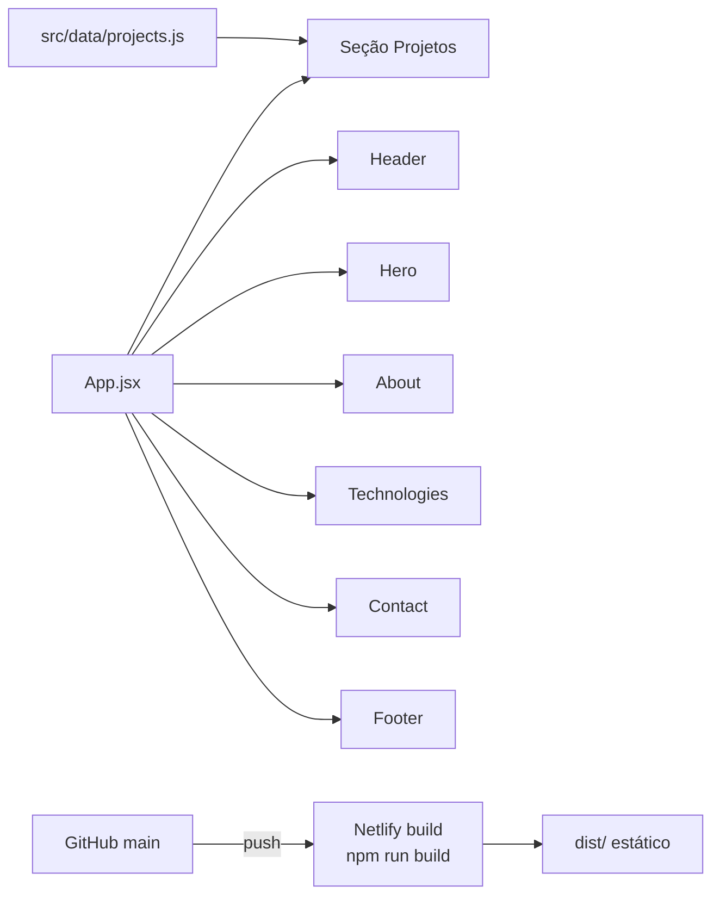

# Pablo Costa — Portfólio

Site pessoal de Pablo Costa, desenvolvedor backend: trajetória, tecnologias e projetos, para recrutadores e
quem quiser conhecer meu trabalho.

[](https://app.netlify.com/projects/portfolio-pablosscosta/deploys)


## Demonstração
No ar em **[portfolio-pablosscosta.netlify.app](https://portfolio-pablosscosta.netlify.app/)**.

## Funcionalidades
- Página única com as seções Início, Sobre, Tecnologias, Projetos e Contato.
- Header fixo que destaca a seção visível no momento (IntersectionObserver) e menu responsivo no celular.
- Animação de entrada das seções ao rolar a página, desligada para quem prefere menos movimento
  (`prefers-reduced-motion`).
- Projetos vindos de um arquivo de dados (`src/data/projects.js`): um projeto em destaque com imagem, links
  para o repositório e a demo, e uma grade de projetos secundários completada com cards "Em breve".
- Layout responsivo para desktop, tablet e celular.

## Tecnologias
| Tecnologia | Por quê |
| --- | --- |
| React 19 | Componentes pequenos e reutilizáveis para as seções e os cards de projeto |
| Vite 8 | Dev server e build rápidos, sem configuração extra |
| CSS puro (um arquivo por componente) | O site é pequeno; não justifica framework de CSS nem CSS-in-JS |
| lucide-react / react-icons | Ícones como componentes, sem carregar fontes de ícones |
| ESLint | Padrão de código e regras dos hooks do React |
| Netlify | Hospedagem estática gratuita com deploy automático a cada push na `main` |

## Arquitetura


É uma SPA estática de página única: o `App.jsx` monta as seções em ordem, e a navegação usa âncoras
(`#projects`), então não há roteador. Os projetos ficam separados da apresentação em `src/data/projects.js`:
adicionar um projeto é editar só esse arquivo. O build e a versão do Node estão versionados em
`netlify.toml`, para o deploy não depender de configuração no painel.

## Como rodar localmente
Pré-requisitos: Node.js 20.19+ ou 22.12+ (exigência do Vite 8; o deploy usa Node 24). Não há variáveis de
ambiente.

```bash
npm ci
npm run dev        # http://localhost:5173
npm run lint
npm run build      # gera dist/
npm run preview    # serve o build de produção
```

## Testes
Ainda não há testes automatizados. A verificação hoje é `npm run lint` e `npm run build`. Adicionar Vitest +
Testing Library está nos próximos passos.

## Decisões e aprendizados
- **Dados separados da apresentação:** os projetos vivem em `src/data/projects.js`; os componentes só
  renderizam o que existe (links reais ou "em breve").
- **Cards "Em breve" calculados, não cadastrados:** são preenchimento de layout, então a seção calcula quantos
  faltam para fechar a grade, e um projeto novo ocupa o lugar de um deles sozinho.
- **Grade em vez de carrossel:** com poucos projetos, a grade mostra tudo de uma vez, é só CSS e funciona
  bem no celular.
- **Configuração de deploy como código:** `netlify.toml` fixa o comando de build, a pasta publicada e a
  versão do Node.

## Próximos passos
- Testes com Vitest + Testing Library.
- Migrar para TypeScript em modo strict.
- CI no GitHub Actions (lint, build e testes em todo PR).
- Página "Ver todos os projetos" quando houver mais projetos.
- Adicionar uma licença.

## Autor
**Pablo Costa**
- LinkedIn: [linkedin.com/in/pablosilva013](https://www.linkedin.com/in/pablosilva013)
- GitHub: [github.com/pablosscosta](https://github.com/pablosscosta)
- Portfólio: [portfolio-pablosscosta.netlify.app](https://portfolio-pablosscosta.netlify.app/)
